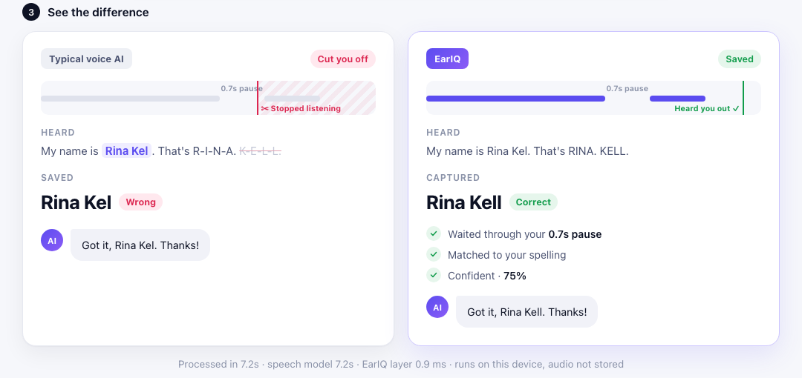
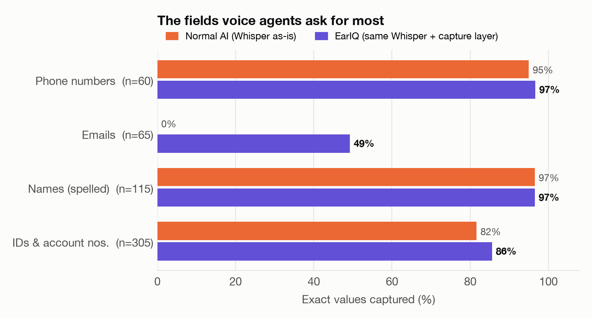

# EarIQ

**Voice AI that gets the details right.** EarIQ is a plug-in capture layer for voice assistants and voice agents. It captures phone numbers, emails, names and IDs **exactly**, waits while people pause in the middle of a value, and asks only about the part it is unsure of.

NLP course · Industry Track · Janhvi Yadav (230117) · Ronit Choudhary (230074) · Asmit Kumar (230063) · Vaishnav Verma (230160)



## Run it (2 commands)

```bash
python3 -m venv .venv && .venv/bin/pip install -r requirements-app.txt
.venv/bin/uvicorn app.server:app --port 8000      # open http://localhost:8000
```

The speech model (Whisper large-v3-turbo, ~1.6 GB) downloads on first start and runs **on your machine**: Apple-silicon GPU if available, otherwise CPU. No API keys, no audio leaves the device. Docker: `docker compose up --build`.

| Page | What it shows |
|---|---|
| `/` | The product: choose what the agent asks for, speak (or play a sample), see **typical voice AI vs EarIQ** side by side |
| `/monitor` | Live monitoring: latency p50/p95, follow-up rate, errors, alerts, recent requests (values masked) |
| `/docs` | Interactive API docs (`POST /api/v1/capture`, `/api/v1/health`, `/api/v1/metrics`, `/metrics`) |

## How it works

| | Smart listening | Format-aware hearing | Smart double-check |
|---|---|---|---|
| **Problem** | A fixed silence timeout cuts people off mid-number | "nine eight seven…" is not a value software can use | Re-asking everything annoys people; guessing saves wrong data |
| **EarIQ** | Waits longer while a value is provably unfinished (pauses measured from audio + a trained "finished?" model) | Spoken forms → exact values: digits, spelled letters, "at the rate", dot/dash/underscore, Hindi digit words; format checks | Saves when sure, confirms only the unsure part, asks again when the format is invalid; never invents a digit |

## Results

Same speech model (Whisper large-v3-turbo) with and without EarIQ. Test sets were never used for tuning.

| What we measured | Normal AI | EarIQ | M1 target |
|---|---|---|---|
| Exact values, all 26 types (VoiceCodeBench, 300 real recordings, 1,482 values) | 57.6% | **70.8%** (−31% errors) | −30% errors ✅ |
| Exact values, phones / emails / names / IDs (545 values) | 76.5% | **84.8%** (−35% errors) | |
| Recordings with every value exact | 12.0% | **20.3%** | |
| Values fixed / broken by EarIQ | | **195 fixed / 0 broken** | |
| Cut-offs while dictating, 0.9 s pause inside the value (synthetic voices) | 100% | **6.8%** (−93%) | −50% ✅ |
| Cut-offs in open conversation, same average wait (LiveKit held-out half) | 11.3% | 11.0% (no significant change) | not met |
| Follow-up questions per 5 values | | **0.4** | ≤ 1 ✅ |
| Hindi / Hinglish test WER (467 clips; same model, hint lists didn't help) | 38.7% | 38.7% | |
| Added delay from EarIQ (p95, API) | | **0.9 ms** | < 200 ms ✅ |
| Answer latency on a laptop (p50 / p95) | | 5.8 s / 6.5 s | |



Full method, error analysis and limitations: **[Technical report (PDF)](docs/report/EarIQ_Technical_Report.pdf)**. Every run is logged in [`results/experiment_log.csv`](results/experiment_log.csv).

## Reproduce the evaluation

```bash
.venv/bin/pip install -r requirements.lock.txt -r requirements-app.txt
.venv/bin/python scripts/acquire_data.py && .venv/bin/python scripts/run_m2.py     # M2 data (≈3.3 GB download)
.venv/bin/python experiments/run_asr.py --split external_entity_test --language en --name vcb_turbo
.venv/bin/python experiments/eval_entities.py        # exact values (VoiceCodeBench)
.venv/bin/python experiments/train_completion.py     # completion model
.venv/bin/python experiments/eval_endpointing.py     # smart listening (LiveKit)
.venv/bin/python experiments/synth.py && .venv/bin/python experiments/eval_dev.py   # synthetic dev set
.venv/bin/python experiments/eval_hindi.py           # Hindi / Hinglish
.venv/bin/python experiments/robustness.py && .venv/bin/python experiments/speed.py
.venv/bin/python experiments/error_analysis.py && .venv/bin/python experiments/make_figures.py
.venv/bin/python -m unittest discover -s tests       # unit + failure-handling tests
```

Cached speech-model outputs are in `results/asr/`, so the scoring steps run in seconds without re-transcribing.

## Repository map

| Path | What |
|---|---|
| `eariq/` | The capture layer: `asr.py` (speech model), `normalize.py` (format-aware hearing), `capture.py` (values, checks, double-check), `endpointing.py` + `vad.py` (smart listening) |
| `app/` | FastAPI service (`server.py`) and the web app / monitor (`static/`) |
| `experiments/` | Every experiment script (M3–M5) and the experiment logger |
| `results/` | Metrics (`*.json`), experiment log, figures, cached ASR outputs |
| `models/` | Trained completion models (scikit-learn) |
| `docs/` | Report, demo script, viva prep, data cards, privacy policy |
| `scripts/`, `src/`, `reports/`, `notebooks/` | M2 data preparation, loader, EDA |

## Handbook checklist (Industry Track)

| Milestone | Deliverable | Where |
|---|---|---|
| M1 | Problem brief, users, objective, success metrics, feasibility | M1 deck PDF, `M1 script.md`, report §1 |
| M2 | Data card, EDA, cleaning, splits, privacy | `docs/data_cards/`, `notebooks/M2_EDA.ipynb`, `reports/`, `docs/PRIVACY.md` |
| M3 | Baseline, candidate approaches, version control, experiment log | `eariq/`, `experiments/`, Git history, `results/experiment_log.csv` |
| M4 | Evaluation report, error analysis, improvement iterations, robustness, optimisation, inference | Report §5–8, `results/*.json`, `experiments/run_asr.py` (batch inference) |
| M5 | Working app/API, deployment, performance, monitoring, failure handling | `app/`, `Dockerfile`, `results/performance.json`, `/monitor`, `tests/test_capture_layer.py` |
| M6 | Technical report, GitHub repo, live demo, business presentation, viva | `docs/report/`, this repo, `docs/DEMO_SCRIPT.md`, `docs/EarIQ_Presentation.pptx`, `docs/VIVA_PREP.md` |

## Data and privacy

Public, licensed datasets only (VoiceCodeBench, LiveKit eot-bench, IndicContextEval); raw audio is not redistributed. All demo and development voices are synthetic and all values are fictional. The app stores no audio and masks values in its logs. See [`docs/PRIVACY.md`](docs/PRIVACY.md).
