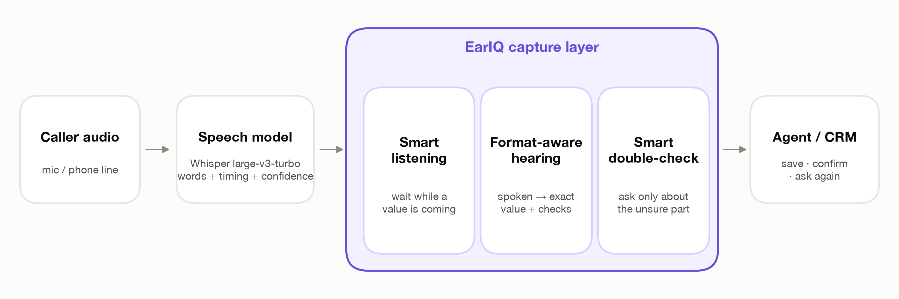
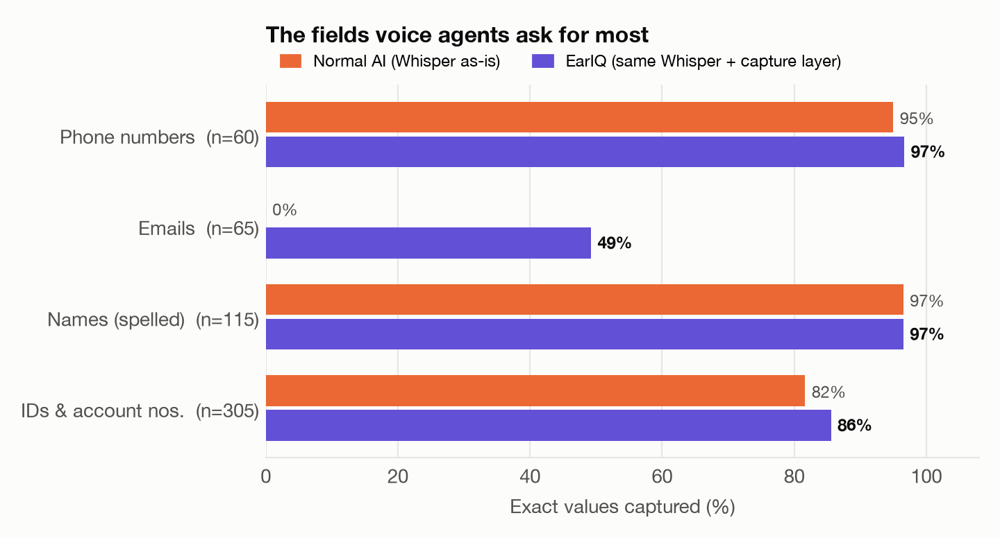
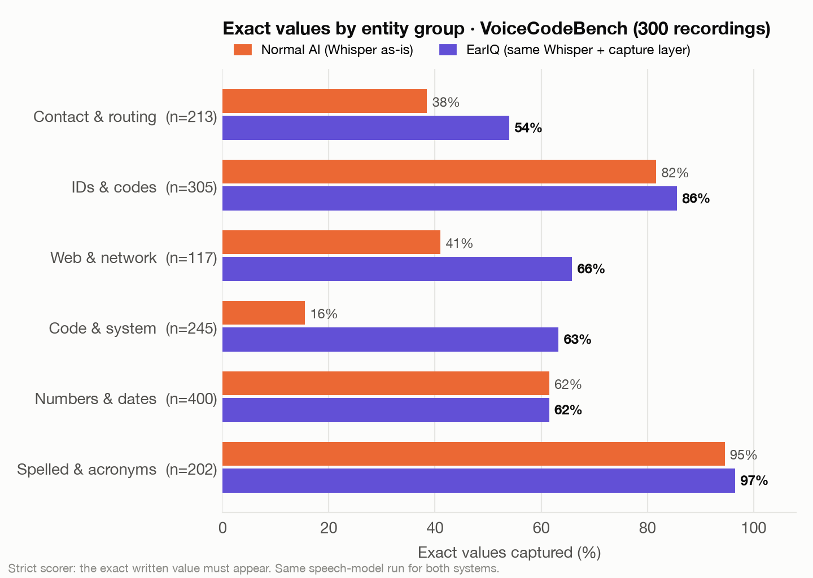
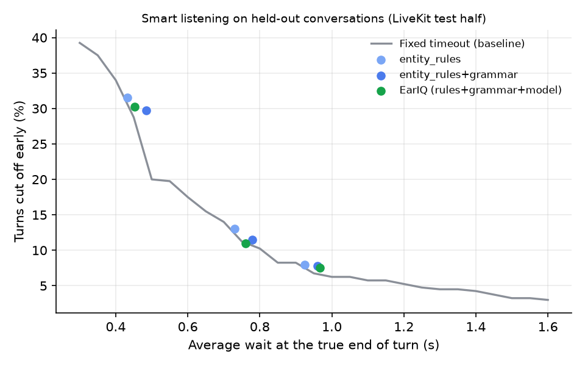
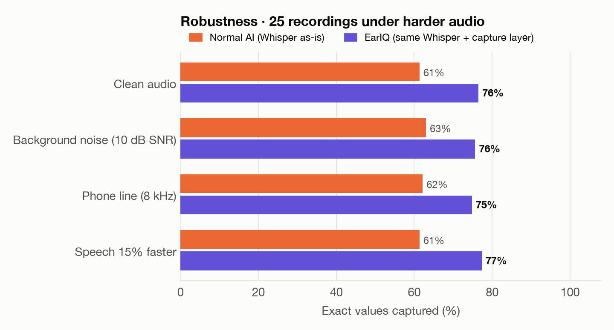
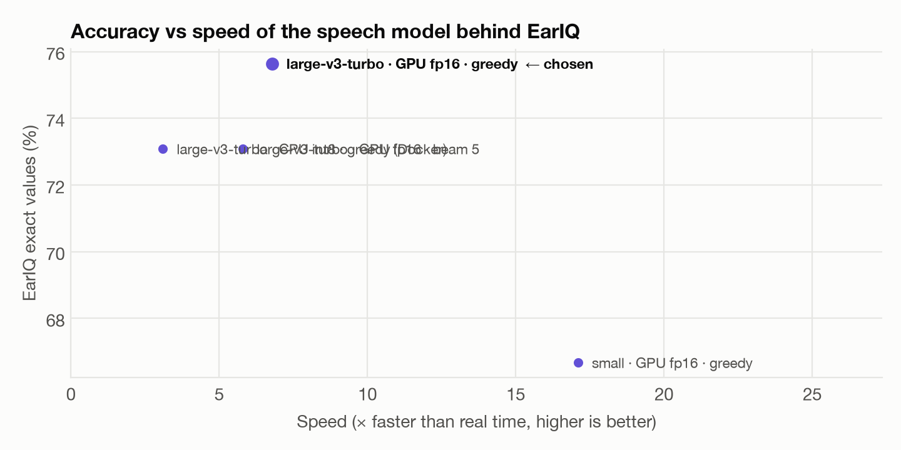
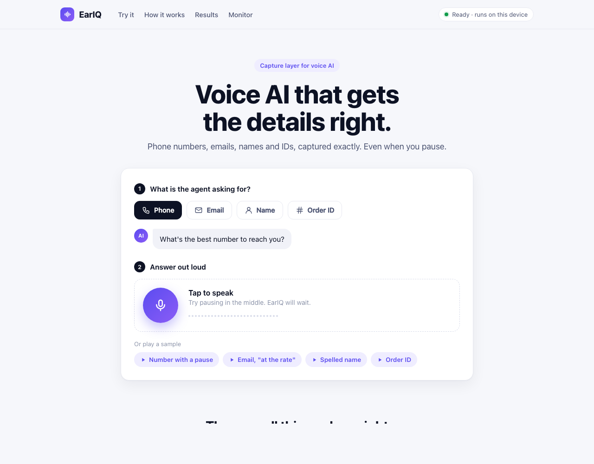
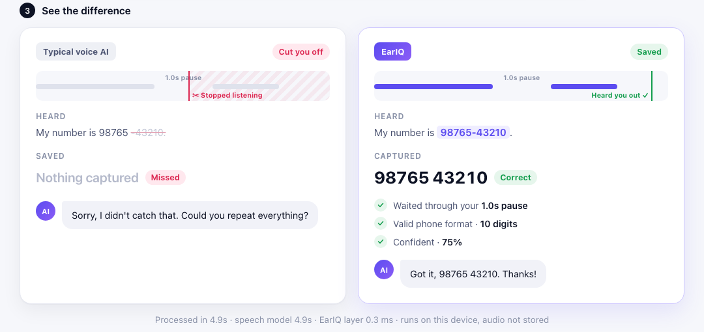
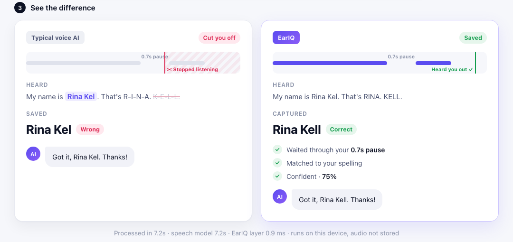
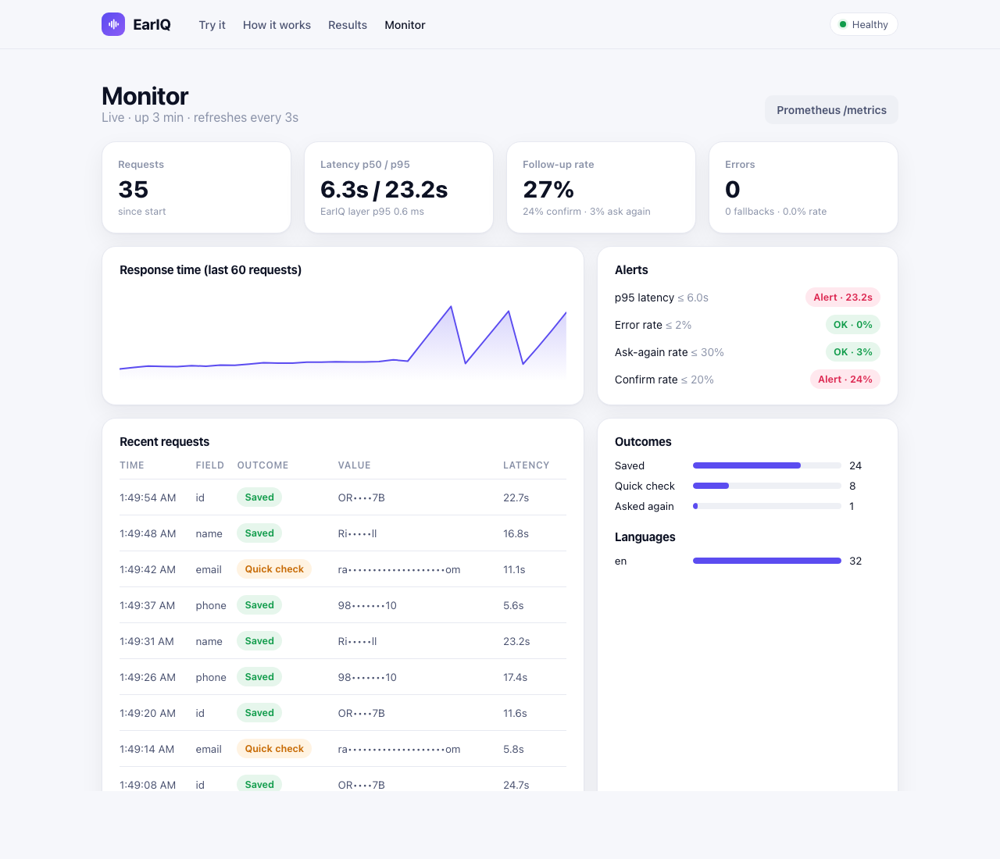

::: cover
[NLP Course · Industry Track · Final Report (Milestones 1–6)]{.tag}

# EarIQ

[An entity-aware capture layer that helps voice AI get the details right: phone numbers, emails, names and IDs, captured exactly, even when people pause.]{.sub}

::: meta
**Team:** Janhvi Yadav (230117) · Ronit Choudhary (230074) · Asmit Kumar (230063) · Vaishnav Verma (230160)\
**Code:** https://github.com/Janhvi2909/EarIQ\
**Date:** November 2026
:::
:::

# Executive summary

**Problem.** Voice AI mishears the details that matter (phone numbers, emails, names, IDs), cuts people off while they pause mid-number, and standard accuracy scores hide both.

**What we built.** EarIQ, a plug-in capture layer on top of an unchanged speech model (Whisper large-v3-turbo). It has three parts: *smart listening* waits while a value is still coming; *format-aware hearing* turns speech into exact values and checks them; *smart double-check* asks only about the unsure part. It is a working product: web app, REST API, monitoring dashboard, failure handling and Docker image, running fully on a laptop with no paid APIs.

**Results against the targets set in M1** (same speech model with and without EarIQ; test data never used for tuning):

| M1 target | Result | |
|---|---|---|
| ≥ 30% fewer wrong values | **−31%** on 1,482 real values (57.6% → 70.8%); −35% on phones/emails/names/IDs (76.5% → 84.8%); 195 fixed, 0 broken | ✅ |
| ≥ 50% fewer cut-offs mid-value at matched delay | **−93%** while dictating (synthetic voices); in open conversation (real calls) −22–26% inside values but no significant overall change | ✅ / partly |
| ≤ 1 follow-up question per 5 answers | **0.4 per 5** | ✅ |
| < 200 ms added delay (p95) | **0.9 ms** | ✅ |

Hindi / Hinglish: same model, WER 38.7% without hints. Robustness: EarIQ's gain holds under background noise, phone-line audio and faster speech. The main remaining errors are near-miss formats (times, addresses, currency) and mishearings, which are the next steps.

# 1. Problem and business case (M1)

## 1.1 Problem brief

Voice AI can now *talk* like a human, but it still does not *listen* like one. In assistants, dictation, voice search and voice agents, three failures recur:

1. **It mishears the words that matter**: names, phone numbers, emails, order and account IDs, and Hinglish words.
2. **It cuts people off**: a fixed silence timeout ends the turn while the person is pausing in the middle of a number or a spelling.
3. **Standard scores hide it**: Word Error Rate (WER) weights every word equally, so one wrong digit in an account number barely moves WER, yet the downstream task fails.

Evidence collected in M1: the Voice of India benchmark reports 295.9% WER for GPT-4o Mini Transcribe on Gujarati (benchmark-specific extreme); an AssemblyAI survey finds 55% of voice-agent users name repeating themselves as their top frustration; and VoiceCodeBench shows that even a strong commercial model (Deepgram Nova-3) recovers 90.9% of entities but gets *every* entity right in only 68.7% of recordings.

## 1.2 Users

| Group | Who | What they need |
|---|---|---|
| Primary | Voice-AI builders and platforms (Sarvam, Bolna, Vapi-type) | A plug-in layer that makes captured values reliable without changing their speech model |
| Business customers | Banking, healthcare, commerce, travel, support | Correct records on the first try; fewer repeats and human hand-offs |
| End users | People speaking Indian English, Hinglish, Hindi | Not being cut off; not repeating everything because one digit was wrong |

## 1.3 Business objective and success metrics

**Objective:** get required information correct the first time, with fewer repeats and corrections, without adding noticeable delay. EarIQ is a **plug-in layer**, not a new speech model.

| Metric (fixed in M1) | Definition | Target |
|---|---|---|
| Exact value accuracy | Correct exact values / required values (missing or wrong = fail) | **≥ 30% relative error reduction** vs the same speech model without EarIQ |
| Cut-offs mid-information | Turns ended early while the person was still giving a value | **≥ 50% fewer** at the same average waiting time |
| Clarification burden | Follow-up questions per eligible answer | **≤ 1 per 5** answers |
| Added delay | Extra processing time added by the layer | **p95 < 200 ms** |

## 1.4 Feasibility (as planned, and as it turned out)

Planned: licensed public speech data, open-source models, a lightweight decision layer, no paid APIs. Outcome: the whole system runs on a student laptop (Apple M3, 16 GB): Whisper large-v3-turbo on the Mac GPU, a rule-based formatter, a small scikit-learn model, and a FastAPI app. Total API cost: **₹0**. No audio leaves the device.

# 2. Data understanding and preparation (M2 recap)

Full details are in `reports/M2_Data_Report.md` and `docs/data_cards/`. Three complementary sources, **4,202 recordings / 17.2 hours**, each used for a different question:

| Source | Size | Role in M3–M6 |
|---|---|---|
| **VoiceCodeBench** (English, 26 entity types) | 300 recordings, 1,482 exact values, 85 speakers | External test for exact values. Never used for training or tuning |
| **LiveKit eot-bench** (English + Hindi turns) | 800 turns, 1,524 hold pauses + 800 turn ends | External test for smart listening (turn timing) |
| **IndicContextEval Hindi** (code-mixed, 23 domains) | 3,102 recordings, 124 speakers | Our train / validation / test split: 2,169 / 466 / 467, speaker-disjoint |

Preparation: decoded and checked all audio, exported 16 kHz mono; Unicode NFC cleaning that never strips digits, leading zeros or symbols; silences and self-corrections preserved (they define the problem); eight unusable rows excluded and logged; grouped splits with zero speaker/transcript/audio overlap; gold labels stored separately from model inputs. Privacy: licensed public data only, pseudonymous speaker IDs, raw audio kept out of Git, fictional values for every new recording.

**Added in M3:** a 120-clip **synthetic development set** generated with the Mac's built-in Indian-English (Aman, Rishi, Tara), US and UK voices, reading fictional phone numbers, emails, spelled names and order IDs, 40% with a deliberate pause inside the value. It is used **only** to design rules and choose thresholds, never as evidence of real-world accuracy.

# 3. System design (M3)

| Component | What it does | How |
|---|---|---|
| **Speech model** (baseline) | Audio → words, word timings, word confidence | Whisper large-v3-turbo via faster-whisper, local GPU (fp16) or CPU (int8) |
| **Format-aware hearing** | "nine eight seven six five…" → `98765 43210`; "R I N A" → `RINA`; "priya dot sharma at the rate example dot com" → `priya.sharma@example.com`; "O R D dash four four seven B" → `ORD-447B` | Token rules with provenance: spoken digits (incl. "double/triple", "hundred", Hindi and Hinglish digit words), spelled-letter runs, connectors (dot, dash, underscore, slash, "at the rate"), email/URL/code assembly; validators (phone length, email syntax and domain, ID shape); spelled name overrides a misheard name; self-corrections ("no sorry, …") keep the last value |
| **Smart double-check** | Ask only when needed, and only about the unsure part | Save if the value is valid and its weakest word confidence ≥ 0.5; *confirm* (highlighting the unsure part) if below; *ask again* if the format is invalid or nothing was heard. **Never invents** a missing digit |
| **Smart listening** | Don't end the turn while a value is still coming | Pauses are measured from the audio (energy-based detector). At each pause, wait *long* (1.5 s) instead of *short* (0.6 s) if a value is provably unfinished (e.g. fewer than 10 phone digits, an email with no ending yet, an ID with no digits, a spelling in progress), the sentence is grammatically hanging ("and", "my", "um"), or a trained completion model says the speaker is not done |

**Completion model.** TF-IDF features (character 2–5-grams + word 1–2-grams over the last six words) with logistic regression. Trained on complete vs cut-off sentences: Hindi train split (2,169) plus English intake sentences and SST-2 sentences. Validation accuracy: 73.1% Hindi, 83.6% English. In v2 it was refit with real conversational pauses from the LiveKit development half (Section 6).

**Version control and experiment log.** All code is in the GitHub repository with milestone-tagged commits. Every run appends a row to `results/experiment_log.csv`: run id, time, milestone, track, approach, data, configuration, metrics, runtime and git commit.

# 4. Baselines and evaluation protocol (M3–M4)

**Fair baseline.** For every comparison, *normal AI* is the **same Whisper run** with no EarIQ: same audio, same model, same settings. The only difference is the capture layer, so any gain is caused by EarIQ.

| Track | Baseline | Candidates | Test data (never tuned on) |
|---|---|---|---|
| Exact values | Whisper transcript as-is | Whisper + format-aware hearing (+ double-check) | VoiceCodeBench, 300 recordings |
| Smart listening | Fixed silence timeout | Entity rules → + grammar → + completion model | LiveKit (v2: held-out test half) |
| Hindi / Hinglish | Whisper, no hints | + key-term hint list (L5); unrelated hints (L6) as a robustness check | Hindi test split, 467 recordings |
| Double-check | Never ask / always ask | Confidence + validation targeted questions | VoiceCodeBench |

**Rules that keep the numbers honest.**

- No test set was used to design rules or choose settings. English design used the synthetic dev set; Hindi choices used the validation split; smart-listening v2 settings were chosen on a development half of LiveKit and frozen before the test half was scored.
- **Scorer.** VoiceCodeBench's official scorer is a paid GPT-based verifier. We use a free, deterministic scorer: *exact value* (strict) means the canonical written value appears in the output (ignoring case and spaces; phone/ID numbers also ignore separators); *recoverable* (lenient) also accepts the spoken form. Our strict scorer is harsher than the official one, so absolute numbers are lower than published leaderboard numbers; comparisons between systems are on the same scorer.
- VoiceCodeBench's official setting forbids post-processing. EarIQ results are therefore a separate "with capture layer" condition, **not a leaderboard entry**. Published vendor scores are reference points only.
- Uncertainty: 95% confidence intervals from **speaker-grouped bootstrap** (2,000 resamples; whole speakers or conversations are resampled, because recordings from the same person are not independent).

# 5. Results: exact values (M4)

**Setup.** VoiceCodeBench, all 300 recordings, 1,482 target values across 26 types. One Whisper large-v3-turbo run (GPU, fp16, greedy); normal AI = its transcript, EarIQ = the same words through the capture layer.

| Metric | Normal AI | EarIQ | Change |
|---|---|---|---|
| **Exact values (strict)** | 57.6% | **70.8%** | **−31.1% relative error** (95% CI of gain: +11.1 to +15.3 points) |
| Recordings with *every* value exact | 12.0% | **20.3%** | ×1.7 |
| Recoverable values (lenient) | 66.3% | 71.3% | −15.0% relative error (CI +3.9 to +6.3 points) |
| **Priority fields** (phones, emails, names, IDs; n = 545) | 76.5% | **84.8%** | −35.2% relative error |
| Values fixed by EarIQ / broken by EarIQ | | | **195 fixed / 0 broken** |

**M1 target (≥ 30% relative error reduction): met** (31.1% on all 26 types; 35.2% on the priority fields).

| Entity group | n | Normal AI | EarIQ |
|---|---|---|---|
| Contact & routing (email, phone, extension, name, address) | 213 | 38.5% | 54.0% |
| IDs & codes | 305 | 81.6% | 85.6% |
| Web & network (URL, IP, port) | 117 | 41.0% | 65.8% |
| Code & system (command, flag, path, env var, symbol, version) | 245 | 15.5% | 63.3% |
| Numbers & dates | 400 | 61.5% | 61.5% |
| Spelled & acronyms | 202 | 94.6% | 96.5% |

**Accent slice (small samples, indicative only).** Indian-accented speakers: 38.5% → 57.7% (n = 26 values); Nigerian: 48.7% → 61.8% (n = 76); US general: 58.1% → 71.5% (n = 919). The gain holds across accents, but VoiceCodeBench has very little Indian speech, which is why the synthetic Indian-English practice set and the Hindi track exist.

**Reference point (not comparable as a leaderboard entry).** The VoiceCodeBench paper reports Whisper large-v3 at 87.6% CTEM with its GPT-based verifier. Our normal-AI number is lower because our scorer is stricter (exact written value) and we use the turbo model with greedy decoding. Both systems are scored identically here.

**Evaluation iteration (scorer fairness).** Our first scorer compared spelled sequences ("R I N A") with separators intact, which wrongly penalised Whisper's hyphenated "R-I-N-A". We changed the scorer to ignore separators inside spellings and acronyms. This *reduced* EarIQ's measured gain (from 38% to 31% relative), and we report the fairer number.

## 5.1 Smart double-check

| Policy | Questions per 5 values | Wrong values caught |
|---|---|---|
| Never ask | 0 | 0% |
| Always confirm everything | 5.0 | 100% (but every caller repeats everything) |
| **EarIQ (ask when weakest-word confidence < 0.5 or format invalid)** | **0.41** | **15.0%** (54% of its questions point at a real error) |

**M1 target (≤ 1 question per 5 answers): met.** The catch rate is modest: most remaining errors are confident near-misses (Section 8), which a confidence threshold cannot see. The threshold (0.5) was chosen on the synthetic dev set as the largest value keeping questions ≤ 20%.

# 6. Results: smart listening (M4)

## 6.1 Dictation (agent knows the field it asked for)

Synthetic dev set, 44 clips with a 0.9 s pause inside the value, pauses measured from the audio exactly as in the product. A fixed 0.6 s timeout cut off **100%** of them; EarIQ (same 0.6 s wait after complete answers, 1.5 s only while a value is unfinished) cut off **6.8%**: **93% fewer cut-offs**. Neither cut off any fluent clip. *Caveat:* synthetic voices with a constructed pause. This shows the mechanism works; Section 6.2 is the stricter test on real calls.

## 6.2 Open conversation (LiveKit, real English and Hindi calls)

Protocol: conversation-grouped 50/50 split per language into **dev (400 turns)** and **test (400 turns)**. Settings chosen on dev for each delay budget, then frozen. On test, the fixed-timeout baseline is set to *exactly* EarIQ's measured average delay.

| Delay budget | Method | Avg wait (s) | Turns cut off early | Baseline at same wait | 95% CI of difference |
|---|---|---|---|---|---|
| 0.5 s | EarIQ (rules + grammar + model) | 0.45 | 30.3% | 28.8% | −2.2 to +5.4 pts |
| **0.8 s** | **EarIQ** | **0.76** | **11.0%** | **11.3%** | −2.5 to +1.9 pts |
| 1.0 s | EarIQ | 0.97 | 7.5% | 6.8% | −1.4 to +3.2 pts |
| 0.8 s | Entity rules only | 0.73 | 13.0% | 11.3% | +0.5 to +3.2 pts (worse) |

**Inside-value pauses** (37 test turns with a pause between two digits or spelled letters): EarIQ cuts off 18.9% vs 24.3% at 0.8 s, 13.5% vs 16.2% at 1.0 s, 46.0% vs 62.2% at 0.5 s, so **22–26% fewer**, but on too few turns to be conclusive. By language at 0.8 s: English 14.0% vs 15.5% (better), Hindi 8.0% vs 7.0% (slightly worse).

**M1 target (≥ 50% fewer cut-offs mid-information at matched delay): met on dictation (93%), not met in open conversation** (22–26% fewer inside values, no significant overall change). In general conversation, people rarely pause *inside* values, and turns often legitimately end right after a value, so "a number was just said" is a weak signal there.

# 7. Results: Hindi and Hinglish (M4)

**Setup.** IndicContextEval Hindi, our speaker-disjoint split. Same Whisper large-v3-turbo; only the hint list changes. Settings compared on a fixed 100-clip validation subset; the 467-clip test split was scored once with the baseline and the chosen setting. WER/CER after removing punctuation; *borrowed-term error* = share of tagged English-origin terms (e.g. "टीम (team)") missing from the output in either script.

| Validation subset (100) | WER | CER | Borrowed-term error |
|---|---|---|---|
| No hints (baseline) | 38.1% | 19.3% | 34.8% |
| Key-term hints (L5) | 38.4% | 18.1% | 47.8% |
| Unrelated hints (L6) | 37.3% | 15.8% | 52.2% |

Chosen on validation: **No hints (baseline)**.

| Test split (467 clips) | WER | CER | Borrowed-term error |
|---|---|---|---|
| No hints (baseline) | 38.7% | 21.2% | 36.2% |

| Code-mixed clips only (test) | WER | CER | Borrowed-term error |
|---|---|---|---|
| No hints (baseline) | 41.1% | 25.0% | 36.9% |

**Reading.** Hindi is much harder for the same model than English (WER 38.7% vs about 22% on English workplace speech). **Hint lists did not help Whisper.** On validation, key-term hints left WER unchanged (38.4% vs 38.1%) and *raised* borrowed-term error (47.8% vs 34.8%). Even *unrelated* hints lowered CER (15.8% vs 19.3%). This means a Hindi-script prompt mainly shifts the output script (English loanwords get written in Devanagari with spellings that differ from the reference), rather than teaching vocabulary. So the no-hint setting was chosen and is what EarIQ uses. Real contextual biasing for Hindi needs a different mechanism (keyword boosting during decoding, or fine-tuning on the train split), which is listed as future work. Hindi digit words (एक, दो, तीन…) and Hinglish digits (ek, do, teen…) are also handled by format-aware hearing.

# 8. Error analysis (M4)

Of the 1,482 values, **433 are still wrong after EarIQ**. EarIQ fixed 195 values that normal AI got wrong and **broke none**. Each remaining error was categorised automatically by comparing the exact value with every span of EarIQ's output:

| Category | Share of remaining errors | What it means | Remedy |
|---|---|---|---|
| **Near miss** (≥ 80% character similarity) | 76.0% (329) | A format variant ("8.30" for "8:30 PM ET", "$1,200" for "$1200") or a one-letter slip ("Fernandez" for "Fernandes") | More format rules; double-check for slips |
| **Misheard or missing** | 21.5% (93) | Nothing close to the value in the output | Better speech model, hints, double-check |
| **Heard, format not covered** | 2.5% (11) | The spoken form is there but no rule produced the written form | New rules |
| Broken by EarIQ | 0% (0) | | |

Worst entity types after EarIQ: **time** (0% exact; Whisper writes "8.30 to 9.15 PM", the canonical form is "8:30-9:15 PM ET"), **phone extension** (10%; canonical "ext4821"), **postal address** (12.5%; state abbreviations and commas), **command** (24%), **currency** (38.7%), **file path** (39.2%), **measurement** (41.0%). All of these are formatting conventions, so they are the clearest next rules to add. Representative examples:

| Spoken | Exact value needed | Closest EarIQ output | Category |
|---|---|---|---|
| "from six forty five to seven ten A M Central" | `6:45-7:10 AM CT` | `6.45 to 7.10 AM` | Near miss (time format) |
| "thirty six thousand five hundred seventy three dollars and nineteen cents" | `$36573.19` | `$36,573.19` | Near miss (thousands comma) |
| "1200 Aster Avenue Suite 88 Pasadena California 91101" | `1200 Aster Avenue, Suite 88, Pasadena, CA 91101` | `1200 Aster Avenue Suite, 88 Pasadena, CA 91101` | Near miss (comma placement) |
| "B I L L I N G dash O P S at acme dash care dot example dot net" | `billing-ops@acme-care.example.net` | `billingops@acme-care.example.net` | Near miss (speech model dropped the "dash") |
| "T A R A dot V O S S at be simple dot A I" | `tara.voss@besimple.ai` | `tara.voss at bsample.ai2` | Misheard ("be simple" → "bsample") |
| "extension four eight two one" | `ext4821` | `4821` | Near miss (extension format) |

All examples are real outputs from the benchmark run. Several near misses (thousands commas, comma placement) would be accepted by a more lenient checker; we keep the strict rule because downstream software often needs the exact form.

# 9. Improvement iterations (M4)

All iterations were driven by the dev set or by dev halves, never by test results.

| # | Component | Change | Why (evidence) | Effect |
|---|---|---|---|---|
| v0 | Capture layer | First rule set | | Dev: EarIQ 23% vs normal AI 67% (worse!) |
| v1 | Capture layer | Re-join Whisper's word pieces ("INV" + "-53554") | Dev error inspection: IDs and phones split into pieces | Dev: 23% → 73% |
| v1.1 | Capture layer | Two-word email names; snap near-miss domains ("examal.com" → example.com); split one spelled run into first and last name; lone first letter ("K, A-R-A-N") | Dev error inspection | Dev: 73% → 74.2% |
| v1 | Smart listening | Entity rules + grammar + read-speech completion model | | LiveKit (all 800): **worse** than fixed timeout at every delay |
| v2 | Smart listening | Value rules fire only when provably unfinished; model refit on real pauses (dev half); per-language dev/test protocol | v1 flagged real endings after numbers as unfinished | Test: on par overall, 22–26% fewer in-value cut-offs |
| v2.1 | Smart listening (product) | Pauses from audio energy instead of Whisper word gaps; ID and spelling rules | Whisper stretches words across silences | Demo shows real pauses; dictation 93% fewer cut-offs |
| eval | Scorer | Separators ignored in spellings and acronyms | Fairness to the baseline | EarIQ gain 38% → 31% (reported) |

# 10. Robustness (M4)

Same 25 VoiceCodeBench recordings, re-transcribed under three harder conditions; strict exact-value scorer.

| Condition | Values | Normal AI | EarIQ | EarIQ gain |
|---|---|---|---|---|
| Clean | 119 | 61.3% | 76.5% | +15.1 pts |
| Background noise, 10 dB SNR | 119 | 63.0% | 75.6% | +12.6 pts |
| Phone line (8 kHz, 300–3400 Hz) | 119 | 62.2% | 74.8% | +12.6 pts |
| Speech 15% faster | 119 | 61.3% | 77.3% | +16.0 pts |

EarIQ's gain is preserved under every condition: the layer depends on what the speech model writes, not on the audio, so it keeps adding value as long as the words survive. Other robustness slices are reported with each result: accents (§5), English vs Hindi and code-mixed speech (§6–7), Indian-English vs US/UK synthetic voices (dev set: EarIQ 72.2% vs 68.1% and 77.1% vs 64.6%).

# 11. Optimisation and inference (M4)

15 VoiceCodeBench recordings (16.9 minutes of audio) per setting, on Apple M3 MacBook, 16 GB.

| Speech-model setting | × faster than real time | Normal AI exact | EarIQ exact |
|---|---|---|---|
| small · GPU fp16 · greedy | 17.1× | 52.6% | 66.7% |
| large-v3-turbo · GPU fp16 · greedy (chosen) | 6.8× | 59.0% | 75.6% |
| large-v3-turbo · GPU fp16 · beam 5 | 5.8× | 56.4% | 73.1% |
| large-v3-turbo · CPU int8 · greedy (Docker) | 3.1× | 57.7% | 73.1% |

**Choice.** large-v3-turbo on the GPU with greedy decoding: the best accuracy-per-second trade-off. Beam search costs extra time for little gain; the small model is fastest but loses accuracy; the CPU int8 build is what the Docker image uses on machines without a GPU. **EarIQ's own processing** over all 300 recordings (about 67 s each, whole transcript at once): p50 0.79 ms, p95 1.06 ms, max 1.3 ms.

**Batch inference.** `experiments/run_asr.py` transcribes any split resumably and caches outputs with their configuration; all scoring scripts run on cached outputs in seconds. **Online inference** is the API in Section 12.

# 12. Deployment prototype (M5)

**Application.** A product-style web page (no tutorial text): pick what the agent asks for, speak or play a sample, see where each system stopped listening (timeline), what it heard, what it saved, and EarIQ's checks and next line (save / confirm / ask again).

**API.**

| Endpoint | Purpose |
|---|---|
| `POST /api/v1/capture` | Audio (WAV) + field → transcript, values, confidence, action and question, timeline, latency breakdown |
| `POST /api/v1/feedback` | Caller confirmed / rejected a value (a production accuracy signal) |
| `GET /api/v1/health` | Model status, device, uptime |
| `GET /api/v1/metrics`, `GET /metrics` | JSON metrics for the dashboard; Prometheus text for standard monitoring |
| `GET /monitor` | Live monitoring dashboard |

**Deployment.** Runs as one process (`uvicorn app.server:app`), on the Mac GPU or on CPU. A `Dockerfile` and `docker-compose.yml` package it (CPU int8 build, model cached in a volume, health check). The speech model loads and warms up at start-up; requests queue for the GPU one at a time.

**Performance measurements.**

Measured on the running API (Apple M3 MacBook, 16 GB, speech model on the Mac GPU (large-v3-turbo fp16)), using the four demo clips (about 4.16 s of speech each).

| Measurement | Result |
|---|---|
| Latency per answer, one user (p50 / p95) | 5.77 s / 6.46 s |
| Speech model speed | 0.7× faster than real time |
| **EarIQ layer, added time (p50 / p95)** | **0.3 ms / 0.9 ms** (M1 target < 200 ms ✅) |
| 4 users at once (p50 / p95 latency) | 14.75 s / 23.88 s (requests queue for the GPU) |
| Throughput with 4 users | 10.2 answers per minute |
| Success rate (valid requests) | 100.0% sequential, 100.0% concurrent |
| Failure paths (empty / corrupt / silent audio) | HTTP 400 / 400 / 200 with a clear message, no crash |
| Server memory | 250 MB |

**Monitoring strategy.**

| Signal | Why | Alert |
|---|---|---|
| Latency p50 / p95, EarIQ layer time | User experience; capacity | p95 > 6 s |
| Error rate, fallback count | Crashes, timeouts, degraded answers | errors > 2% |
| Ask-again rate | Rises with bad audio, a new accent, or model drift | > 30% |
| Confirm rate | Clarification burden (M1 target ≤ 1 in 5) | > 20% |
| Caller feedback (confirmed / rejected) | Real-world accuracy without storing audio | trend |
| Language mix, fields requested | Traffic shift (e.g. more Hinglish) | trend |

Logs are JSON lines with request id, field, outcome, latency and a **masked** value (`98•••••10`); no audio or transcripts are stored.

**Failure handling.**

| Failure | Behaviour | Test |
|---|---|---|
| Empty upload | 400 "No audio received" | ✓ |
| Corrupt / non-audio file | 400 "Couldn't read that audio" | ✓ |
| Silence or < 0.3 s | 200 `no_speech`: "I couldn't hear anything…" | ✓ |
| Longer than 60 s / larger than 10 MB | 400 / 413 with a clear message | ✓ |
| Model still loading | 503 "still loading" | |
| Speech model timeout (45 s) or crash | 503, counted as error, never hangs | |
| More than 4 requests waiting | 429 "busy, try again" | |
| Capture-layer exception | Degrades to the plain transcript and **asks again**; never invents a value | |
| Low confidence / invalid format | Confirm the unsure part / ask again | ✓ |
| Missing digit (9-digit phone) | Ask again ("I got 9 digits…"), never pads or guesses | ✓ |

15 automated tests (`tests/test_capture_layer.py`) cover formatting, capture decisions, listening and the failure paths.

# 13. Business impact

For every **1,000 phones, emails, names and IDs** captured, the measured priority-field rates mean **≈ 235 wrong or unusable values with normal AI vs ≈ 152 with EarIQ**, before any follow-up question. That is about 83 fewer failed callbacks, deliveries or lookups per 1,000 values. Each correction a caller doesn't have to make saves agent time and goodwill; the survey in M1 found repetition is the top frustration. EarIQ costs **₹0 in API fees** (open models on the builder's hardware), adds about a millisecond of processing, and plugs into any speech model a platform already uses. These are illustrations from benchmark rates; real savings need a pilot.

# 14. Limitations and threats to validity

- **Population.** The exact-value test is English workplace speech with only 26 Indian-accented values; Indian-English results come mostly from synthetic voices and the Hindi track. Synthetic voices are cleaner than real callers.
- **Scorer.** Our deterministic scorer differs from the official GPT-based verifier; absolute numbers are not leaderboard-comparable. Matching ignores case and some separators, which is a judgement call; we report strict and lenient versions.
- **Offline timing.** Smart listening is evaluated by replaying recordings, not in a live streaming loop. The LiveKit sample lacks speaker IDs for Hindi, so Hindi turns are bootstrapped individually.
- **Repair not measured.** We measure whether a question is asked and whether it targets a real error, not whether the caller's answer then fixes the value (that needs interactive sessions).
- **Field knowledge.** The demo and dictation results assume the agent knows which field it asked for, which is realistic for voice agents but not for open dictation.
- **Pre-training contamination.** Public benchmarks may overlap with Whisper's training data; this affects both systems equally.

# 15. Future work

1. A pilot with a voice-agent platform on consented Indian-English and Hinglish calls, measuring repair success and hand-offs.
2. Streaming integration (custom transcriber for Vapi / LiveKit) so smart listening runs on live partial transcripts.
3. Format rules for times, extensions, addresses, currency and measurements (the largest share of remaining near misses).
4. Re-ranking several speech-model hypotheses with format checks, and fine-tuning on the Hindi train split.

# 16. Conclusion

EarIQ shows that a small, transparent layer on top of an unchanged speech model can make voice AI get the details right more often: **31% fewer wrong values overall and 35% fewer on the fields agents ask for most, with zero values broken, under one follow-up question per five answers, and about a millisecond of added processing**. It waits through pauses while a value is being dictated. In open conversation it only matches a tuned timeout, which we report as it is. The whole system (speech model, layer, API, monitoring and web app) runs on a student laptop with no paid services.

# Appendix A. M1 targets scorecard

| Target (M1) | Measured | Verdict |
|---|---|---|
| ≥ 30% relative reduction in wrong values vs same speech model | 31.1% (all types); 35.2% (priority fields) | Met |
| ≥ 50% fewer cut-offs mid-information at matched delay | 93% (dictation, synthetic); 22–26% inside values and no overall change (open conversation) | Met for dictation; not met for open conversation |
| ≤ 1 clarification per 5 eligible answers | 0.41 per 5 | Met |
| p95 added processing < 200 ms | 0.9 ms (API); 1.06 ms (offline, 67 s recordings) | Met |

# Appendix B. Handbook checklist (Industry Track) → evidence

| Milestone | Deliverable | Evidence |
|---|---|---|
| M3 | Baseline model | Same-Whisper baseline for every track (§4) |
| M3 | Candidate approaches | Format-aware hearing, double-check, 3 listening variants, Hindi hint variants (§3–4) |
| M3 | Version-controlled implementation | GitHub repository, milestone commits |
| M3 | Experiment log | `results/experiment_log.csv` (every run, config, metrics, commit) |
| M4 | Evaluation report | §5–7, `results/*.json` |
| M4 | Error analysis | §8, `results/error_analysis.json` |
| M4 | Improvement iterations | §9 |
| M4 | Robustness testing | §10, accent and language slices (§5, §6, §7) |
| M4 | Model optimisation / inferencing | §11, `experiments/run_asr.py` |
| M5 | Working application / API, model deployment | §12, `app/`, `Dockerfile` |
| M5 | Performance measurements | §12, `results/performance.json` |
| M5 | Monitoring strategy, failure handling | §12, `/monitor`, `tests/test_capture_layer.py` |
| M6 | Technical report, GitHub, live demo, business presentation, viva | This report, repository, `docs/DEMO_SCRIPT.md`, `docs/EarIQ_Presentation.pptx`, `docs/VIVA_PREP.md` |

# Appendix C. Team contributions

| Member | Main contributions |
|---|---|
| Janhvi Yadav (230117) | Problem framing; capture layer (format-aware hearing, double-check); exact-value evaluation; web app UI; report |
| Ronit Choudhary (230074) | Smart listening: endpointing rules, completion model, LiveKit evaluation v1 → v2 |
| Asmit Kumar (230063) | Hindi / Hinglish evaluation; robustness tests |
| Vaishnav Verma (230160) | API service, monitoring, failure handling, Docker deployment, performance and speed tests |

# Appendix D. Reproduce

See the repository README. All scoring runs from cached speech-model outputs in `results/asr/`; re-transcribing everything takes about 1.5 hours on an Apple M3.

